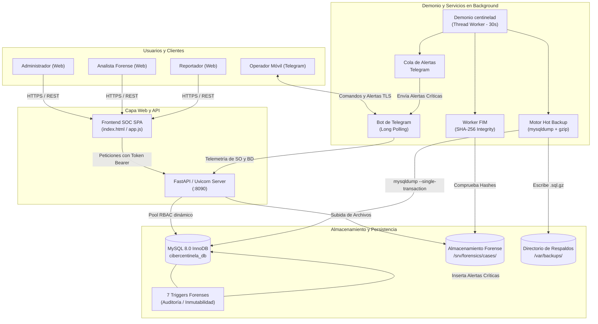

# MANUAL OFICIAL DE DOCUMENTACIÓN TÉCNICA Y OPERATIVA: CIBERCENTINELA
## Plataforma de Gestión de Incidentes (SOC), Análisis Forense Digital y Demonio de Seguridad en Segundo Plano
**Institución:** Universidad Autónoma de Chiapas (UNACH)  
**Facultad / Carrera:** Licenciatura en Tecnologías de Información / Seguridad Informática  
**Asignaturas de Referencia:**  
- Administración de Sistemas Operativos (Dr. Carlos Alberto García Ramos)  
- Respuesta a Incidentes de Seguridad (Mtro. Obeth Regalado Moreno)  
**Versión de la Plataforma:** 1.0.0 (Release Académico / Industrial)  
**Fecha de Publicación:** Noviembre 2026  

---

## ÍNDICE GENERAL

1. [RESUMEN EJECUTIVO Y OBJETIVOS](#1-resumen-ejecutivo-y-objetivos)
2. [CÓMO FUNCIONA EL SISTEMA: ARQUITECTURA GENERAL](#2-cómo-funciona-el-sistema-arquitectura-general)
   - 2.1 Visión Global del Ecosistema
   - 2.2 Principios de Diseño de Seguridad
   - 2.3 Diagrama Integral de Arquitectura y Flujos de Datos
3. [FLUJO OPERATIVO PASO A PASO PARA EL USUARIO](#3-flujo-operativo-paso-a-paso-para-el-usuario)
   - 3.1 Puesta en Marcha y Despliegue del Entorno
   - 3.2 Autenticación Multifactorial y Control de Acceso (RBAC)
   - 3.3 Gestión de Incidentes de Ciberseguridad
   - 3.4 Laboratorio de Análisis Forense Digital y Cadena de Custodia
   - 3.5 Monitoreo de Telemetría del Sistema Operativo (7 KPIs)
   - 3.6 Consola de Control del Demonio (`centinelad`)
   - 3.7 Interacción Remota Mediante el Bot de Telegram
   - 3.8 Auditoría Inmutable y Administración del Sistema
4. [APARTADO TÉCNICO DETALLADO DE LAS TECNOLOGÍAS](#4-apartado-técnico-detallado-de-las-tecnologías)
   - 4.1 El Demonio en Segundo Plano (`centinelad`)
   - 4.2 Bot Interactivo de Telegram y Sistema de Telemetría
   - 4.3 Motor de Base de Datos MySQL 8.0, RBAC y Triggers Forenses
   - 4.4 Backend API Asíncrono: Python, FastAPI y Uvicorn
   - 4.5 Criptografía y Mecanismos Defensivos
   - 4.6 Frontend: Consola SPA de SOC Defensivo
5. [GUÍA DE COMANDOS DEL BOT DE TELEGRAM](#5-guía-de-comandos-del-bot-de-telegram)
6. [RESOLUCIÓN DE PROBLEMAS FRECUENTES (TROUBLESHOOTING)](#6-resolución-de-problemas-frecuentes-troubleshooting)
7. [MATRIZ DE CREDENCIALES, PUERTOS Y RUTAS DE ACCESO](#7-matriz-de-credenciales-puertos-y-rutas-de-acceso)

---

## 1. RESUMEN EJECUTIVO Y OBJETIVOS

**CiberCentinela** es una solución integral de ciberseguridad defensiva y administración de sistemas que combina una plataforma web para Centros de Operaciones de Seguridad (SOC), un laboratorio de peritaje forense digital, un servicio daemon (`centinelad`) de supervisión continua y un bot interactivo de mensajería cifrada vía Telegram.

El sistema fue concebido para resolver de manera automatizada las tres fases críticas del ciclo de vida de la ciberseguridad:
1. **Detección y Monitoreo Continuo:** Supervisión en tiempo real de la salud del sistema operativo (telemetría de 7 KPIs) y verificación constante de la integridad de los artefactos forenses (FIM - File Integrity Monitoring).
2. **Contención y Respuesta Inmediata:** Notificación instantánea a operadores a través de Telegram ante eventos de severidad crítica, mitigación automática de ataques de fuerza bruta y revocación instantánea de credenciales comprometidas.
3. **Análisis Pericial y Auditoría Inmutable:** Registro criptográfico de evidencias digitales bajo algoritmo SHA-256, análisis forense automatizado de cabeceras de correo para mitigación de phishing (verificación de SPF, DKIM y DMARC) y persistencia blindada mediante triggers en MySQL 8.0 que impiden la alteración o eliminación de pistas de auditoría.

---

## 2. CÓMO FUNCIONA EL SISTEMA: ARQUITECTURA GENERAL

### 2.1 Visión Global del Ecosistema

CiberCentinela opera como un sistema distribuido localmente que coordina cinco capas funcionales interconectadas:

1. **Capa de Presentación (Frontend SPA):** Interfaz web moderna estilo SOC nocturno desarrollada con HTML5 semántico, CSS3 con efectos Glassmorphism y JavaScript nativo asíncrono. Permite visualizar incidentes, métricas de hardware, bitácora de eventos, terminal del demonio y herramientas forenses.
2. **Capa de Lógica de Negocio y Control (FastAPI / Uvicorn):** Servidor ASGI en Python de alto rendimiento que expone APIs RESTful seguras, orquesta la autenticación basada en tokens criptográficos, gestiona el control de acceso basado en roles (RBAC) y actúa como puente de comunicación con el motor de base de datos.
3. **Capa del Demonio en Segundo Plano (`centinelad`):** Proceso autónomo multihilo que opera permanentemente en segundo plano sin intervención humana. Se encarga de la verificación periódica de integridad de evidencias (FIM), el vaciado de la cola de alertas críticas hacia Telegram, la ejecución programada de respaldos lógicos en caliente (*mysqldump*) con retención de 7 días y la recolección de telemetría del sistema operativo.
4. **Capa de Comunicación y Alerta Externa (Bot de Telegram):** Agente de mensajería con soporte de Long Polling seguro (HTTPS/TLS) que permite a los administradores autorizados consultar los 7 KPIs del servidor en cualquier momento desde su teléfono móvil o cliente de Telegram, así como recibir alertas de intrusión en tiempo real.
5. **Capa de Persistencia y Seguridad en Base de Datos (MySQL 8.0+ InnoDB):** Base de datos relacional robustecida que implementa tres usuarios de base de datos con privilegios mínimos segregados (`usr_admin_ciber`, `usr_analista_ciber`, `usr_reportador_ciber`), 7 triggers transaccionales y tablas inmutables para garantizar una cadena de custodia forense inquebrantable.

### 2.2 Principios de Diseño de Seguridad

- **Seguridad por Diseño (*Security by Design*):** Cada componente asume la posibilidad de una intrusión y minimiza el radio de impacto. Por ejemplo, los reportadores de incidentes tienen denegado a nivel de motor SQL el permiso de consultar la tabla de usuarios o la bitácora de auditoría.
- **Defensa en Profundidad (*Defense in Depth*):** La seguridad no recae en un solo filtro; existen validaciones de roles en la interfaz web, en los controladores del backend (FastAPI) y en las credenciales de conexión de la base de datos (MySQL).
- **Principio de Menor Privilegio (*Least Privilege*):** Cada usuario y proceso opera únicamente con los privilegios mínimos estrictamente indispensables para desempeñar su función.
- **Cadena de Custodia Criptográfica:** Todo archivo cargado al repositorio forense es sellado con un hash SHA-256 calculado al momento del arribo; el demonio recalcula periódicamente los hashes físicos para detectar manipulaciones no autorizadas.
- **Auditoría Inmutable:** La bitácora transaccional prohíbe cualquier operación `UPDATE` o `DELETE` mediante triggers que lanzan errores `SIGNAL SQLSTATE '45000'`.

### 2.3 Diagrama Integral de Arquitectura y Flujos de Datos



---

## 3. FLUJO OPERATIVO PASO A PASO PARA EL USUARIO

Si una persona u organización desea implementar y utilizar CiberCentinela, debe seguir la siguiente secuencia cronológica de pasos:

### 3.1 Puesta en Marcha y Despliegue del Entorno

1. **Verificar Requisitos del Servidor:**
   - Sistema Operativo: Windows 10/11/Server o Distribución Linux (Ubuntu 20.04/22.04 LTS, Debian, RedHat).
   - Python 3.10 o superior instalado en el PATH.
   - Servidor MySQL 8.0 o superior en ejecución en el puerto 3306.
   - Herramienta `mysqldump` instalada (incluida en MySQL Server).

2. **Clonar o Descomprimir el Proyecto:**
   ```bash
   git clone https://github.com/Jaime-Ibarr4/CiberCentinela.git
   cd CiberCentinela
   ```

3. **Configurar el Entorno Virtual de Python:**
   - En Windows (PowerShell):
     ```powershell
     python -m venv venv
     .\venv\Scripts\Activate.ps1
     pip install -r requirements.txt
     ```
   - En Linux / macOS:
     ```bash
     python3 -m venv venv
     source venv/bin/activate
     pip install -r requirements.txt
     ```

4. **Configuración de Variables de Entorno (`.env`):**
   Copia el archivo modelo `.env.example` hacia `.env` y ajusta las credenciales:
   ```ini
   DB_HOST=127.0.0.1
   DB_PORT=3306
   DB_ROOT_USER=root
   DB_ROOT_PASSWORD=TuPasswordRootMySQL
   DB_NAME=cibercentinela_db

   DAEMON_HOST=127.0.0.1
   DAEMON_PORT=8090
   DAEMON_INTERVAL_SEC=30

   TELEGRAM_BOT_TOKEN=TuTokenDeBotFather
   TELEGRAM_CHAT_ID=TuChatIdNumerico
   TELEGRAM_SIMULATION_MODE=false
   ```

5. **Inicialización de la Base de Datos:**
   Ejecuta el asistente automatizado de base de datos que creará las 9 tablas, los 3 roles de MySQL, los 3 usuarios de sistema, los 7 triggers transaccionales y los registros base:
   ```bash
   python database/setup_db.py
   ```

6. **Arranque de la Plataforma:**
   - Opción automatizada en Windows: Haz doble clic en el archivo `iniciar_centinela.bat`.
   - Opción manual por terminal:
     ```bash
     python centinelad.py
     ```
   El servidor arrancará en: **`http://127.0.0.1:8090`**.

---

### 3.2 Autenticación Multifactorial y Control de Acceso (RBAC)

Al abrir `http://127.0.0.1:8090` en el navegador, el usuario se encontrará con la pantalla de inicio de sesión seguro.

#### Proceso de Inicio de Sesión:
1. **Ingresar Correo Institucional:** Debe ser una dirección válida con terminación `@centinela.local`.
2. **Ingresar Contraseña:** Validada mediante hash bcrypt con factor de coste 12.
3. **Resolver Desafío Anti-Bot (CAPTCHA):**
   - El sistema genera una operación aritmética aleatoria (ej. `¿Cuánto es 7 + 5?`) o presenta el widget de Google reCAPTCHA v2.
4. **Código de Segundo Factor (2FA/TOTP):** Si el usuario tiene habilitado 2FA, se solicita el código temporal de 6 dígitos compatible con Google Authenticator o Authy.
5. **Generación de Sesión Segura:** Si los datos son correctos, el backend emite un token criptográfico de sesión firmado, y la consola carga la interfaz adaptada a las prerrogativas del rol del usuario.

#### Cuentas de Prueba Preconfiguradas:
| Nombre de Usuario | Correo Electrónico | Contraseña | Rol Asignado | Prerrogativas Operativas |
| :--- | :--- | :--- | :--- | :--- |
| **Alexis Ibarra** | `aibarra@centinela.local` | `Admin#Centinela2026!` | **Administrador** | Control total: gestión de usuarios, auditoría forense completa, control del demonio, respaldos en caliente y configuración de Telegram. |
| **Marvin Camacho** | `mcamacho@centinela.local` | `Forense$Marvin2026!` | **Analista Forense** | Gestión y resolución de incidentes, carga y verificación de evidencias (FIM), análisis pericial de cabeceras de correo. |
| **Danna Gómez** | `dgomez@centinela.local` | `Reporta@Danna2026!` | **Reportador** | Registro de nuevos incidentes y consulta de catálogo base. Sin acceso a bitácoras ni administración. |
| **Iván Roblero** | `iroblero@centinela.local` | `Inactivo%Ivan2026!` | **Cuenta Inactiva** | Demostración de revocación de acceso: el sistema rechaza la autenticación arrojando `HTTP 403 Forbidden`. |

#### Mecanismos de Contención Anti-Fuerza Bruta:
- **5 Intentos Fallidos Consecutivos:** La cuenta y la dirección IP atacante son bloqueadas temporalmente durante **30 minutos** (devuelve `HTTP 429 Too Many Requests`).
- **10 Intentos Fallidos Acumulados:** Se activa la contención por aislamiento total: el backend ejecuta una **baja lógica preventiva directa en la base de datos** (`UPDATE usuarios SET activo = 0`), obligando a un administrador a reactivarla manualmente y registrando el evento como crítico en la bitácora inmutable.

---

### 3.3 Gestión de Incidentes de Ciberseguridad

El flujo central de atención a incidentes sigue las directrices del estándar NIST SP 800-61r2:

1. **Registro del Incidente:**
   - Un usuario con rol Reportador, Analista o Administrador hace clic en **"Registrar Incidente"**.
   - Ingresa: Título descriptivo, Categoría (Phishing, Malware, Intrusión, DoS, Fuga de Datos), Nivel de Severidad (Baja, Media, Alta, Crítica) y Descripción detallada de los hechos.
   - El sistema asigna automáticamente un ticket único con formato `TCK-2026-XXX`.

2. **Disparo Automático de Alerta (Trigger en BD):**
   - Si la severidad seleccionada es **Crítica** o **Alta**, el trigger de base de datos `trg_incidentes_after_insert` inserta inmediatamente un registro en la tabla `notificaciones_telegram` con estatus `Pendiente`.
   - En el siguiente ciclo del demonio (o de forma instantánea si el envío automático está encendido), el mensaje es despachado a los teléfonos de los operadores de guardia vía Telegram.

3. **Asignación y Validación de Analista:**
   - Un Administrador o Analista asigna el caso a un especialista.
   - **Garantía por Trigger:** Si se intenta asignar el ticket a un analista cuya cuenta esté deshabilitada (`activo = 0`), los triggers `trg_incidentes_before_insert` o `trg_incidentes_before_update` cancelan la transacción con el error:  
     `"ASIGNACION PROHIBIDA: El analista seleccionado se encuentra inactivo."`

4. **Transición de Estados y Versionado Histórico:**
   - El caso transita ordenadamente: **Abierto** → **En Análisis** → **En Contención** → **Resuelto / Cerrado**.
   - Cada cambio de estado genera automáticamente un respaldo en la tabla `historico_incidentes`, preservando el estado previo, el nuevo estado y el usuario que efectuó la modificación.

---

### 3.4 Laboratorio de Análisis Forense Digital y Cadena de Custodia

#### A. Carga y Sellado de Evidencias Digitales
1. En la pestaña **"Evidencias Forenses"**, el analista asocia un archivo físico (volcado de memoria RAM `.raw`, captura de paquetes `.pcap`, binario sospechoso, logs de servidor) a un ticket existente.
2. Al momento de la subida, el backend calcula en memoria el resumen criptográfico **SHA-256 de 64 caracteres hexadecimales** antes de persistirlo en el directorio seguro `/srv/forensics/cases/TCK-2026-XXX/`.
3. El registro se guarda en la tabla `evidencias_forenses` con el tamaño en bytes, el hash de sellado y el identificador del analista responsable de la custodia.

#### B. Verificación de Integridad en Tiempo Real (FIM)
- El analista puede pulsar el botón **"Verificar Integridad FIM"**.
- El sistema lee el archivo físico en el disco, computa un nuevo hash SHA-256 en bloques de 64 KB y lo compara contra el hash registrado en la base de datos.
- Si coinciden, se muestra el sello en color verde: **"INTEGRIDAD VALIDADA: El artefacto no ha sufrido alteraciones"**.
- Si el archivo fue manipulado o eliminado, se enciende una alerta roja crítica en el panel y se despacha una notificación de emergencia a Telegram.

#### C. Analizador Forense de Cabeceras de Correo Electrónico
1. En la herramienta de análisis forense de correo, el analista pega las cabeceras completas de un mensaje sospechoso (formato estándar RFC 822 / RFC 5322).
2. El motor forense inspecciona:
   - **Autenticación SPF (Sender Policy Framework):** Revisa si la IP de origen está autorizada por el dominio remitente.
   - **Firma DKIM (DomainKeys Identified Mail):** Comprueba si el mensaje fue firmado digitalmente y no sufrió modificaciones en tránsito.
   - **Políticas DMARC:** Determina si el remitente cumple con las directrices de alineación de dominio.
   - **Análisis de Suplantación (*Spoofing*):** Compara el encabezado visible `From:` contra el encabezado real de retorno `Return-Path:` y `Reply-To:`.
   - **Extracción de Saltos de Red (`Received:`):** Identifica la dirección IP pública del emisor original (`X-Originating-IP`).
3. El sistema emite un **Dictamen Pericial Automatizado** clasificando el correo como: *Legítimo*, *Sospechoso de Spoofing* o *Ataque de Phishing Confirmado*, generando un informe técnico descargable.

---

### 3.5 Monitoreo de Telemetría del Sistema Operativo (7 KPIs)

En la sección **"Telemetría & KPIs del Sistema"**, el operador visualiza el pulso vital del servidor en tiempo real:

1. **Uso de CPU:** Porcentaje global de ocupación de procesador, métricas por núcleo y carga promedio (*Load Average* a 1, 5 y 15 minutos).
2. **Memoria RAM:** Porcentaje de ocupación, megabytes utilizados, memoria libre disponible y estado de la memoria Swap.
3. **Almacenamiento en Disco:** Ocupación porcentual de la partición principal, espacio libre restante en gigabytes y particiones montadas.
4. **Estado de Servicios Críticos:** Matriz de disponibilidad de los demonios vitales: SSH (puerto 22), MySQL (puerto 3306), Servidor Web CiberCentinela (puerto 8090) y Demonio `centinelad`.
5. **Tiempo de Actividad (*Uptime*):** Duración ininterrumpida de operación desde el último arranque del servidor.
6. **Conexiones de Red:** Número de sockets activos clasificados por estado (`ESTABLISHED`, `LISTEN`, `TIME_WAIT`) e inventario de direcciones IP externas conectadas.
7. **Métricas de CiberCentinela:** Total de incidentes activos, conteo de artefactos forenses bajo custodia y estatus de los respaldos en caliente.

---

### 3.6 Consola de Control del Demonio (`centinelad`)

Desde la vista de administración del demonio, el usuario puede:
- Visualizar el Identificador de Proceso (**PID**), el tiempo activo y la cantidad de ciclos de monitoreo completados.
- **Forzar Escaneo FIM:** Ejecuta inmediatamente la auditoría sobre todos los archivos del repositorio forense.
- **Despachar Cola de Telegram:** Procesa manualmente las alertas encoladas con estatus `Pendiente`.
- **Ejecutar Respaldo en Caliente (*Hot Backup Now*):** Invoca a `mysqldump` con compresión gzip en una transacción atómica sin suspender el servicio.
- **Consultar la Consola de Eventos:** Inspeccionar las últimas 150 trazas del demonio con niveles `INFO`, `WARN`, `ALERT`, `CRIT` y `ERROR`.
- **Inspeccionar Histórico de Respaldos:** Revisar los archivos `.sql.gz` almacenados en `/var/backups/mysql_cibercentinela/`, su peso en kilobytes y la fecha de creación.

---

### 3.7 Interacción Remota Mediante el Bot de Telegram

Un operador fuera de la oficina puede administrar el servidor a través de Telegram:
1. Abrir la conversación con el bot institucional de CiberCentinela.
2. Enviar el comando `/start` o `/help` para recibir el menú de operaciones.
3. Solicitar el reporte consolidado mediante `/kpis` o `/reporte`.
4. Consultar subsistemas específicos con `/cpu`, `/ram`, `/disco`, `/servicios`, `/uptime`, `/conexiones` o `/incidentes`.
5. Solicitar la generación inmediata de un respaldo en caliente enviando `/backup`.
6. Si un remitente no autorizado intenta interactuar con el bot, el sistema rechaza el mensaje y registra de inmediato la tentativa de intrusión en la bitácora de auditoría forense.

---

### 3.8 Auditoría Inmutable y Administración del Sistema

Exclusivo para el perfil **Administrador**:
- **Visor de Bitácora Forense:** Permite inspeccionar cronológicamente cada acción ejecutada en el sistema, la dirección IP de procedencia, el usuario ejecutor, la tabla afectada y las cargas útiles JSON con los datos anteriores y posteriores a la modificación.
- **Inmutabilidad Garantizada:** Demuestra que la bitácora no puede ser manipulada; cualquier intento de ejecutar `UPDATE` o `DELETE` sobre `bitacora_auditoria` es rechazado con error crítico por los triggers del motor relacional.
- **Administración de Usuarios:** Permite rehabilitar cuentas suspendidas por ataques de fuerza bruta (`activo = 1`), restablecer contraseñas bajo la política criptográfica y cambiar roles operativos.

---

## 4. APARTADO TÉCNICO DETALLADO DE LAS TECNOLOGÍAS

### 4.1 El Demonio en Segundo Plano (`centinelad`)

#### A. Definición y Principio de Funcionamiento
Un *demonio* (*daemon* en entornos tipo Unix/Linux) es un programa informático que se ejecuta como un proceso en segundo plano de manera continua y autónoma, sin mantener una interfaz de terminal interactiva directa vinculada al usuario. Su misión es atender eventos del sistema, ejecutar tareas de mantenimiento preventivo y vigilar la integridad de los servicios.

En CiberCentinela, el demonio está encapsulado en la clase `CentinelaDaemon` dentro del módulo `backend/daemon_worker.py` y se inicializa durante el evento de arranque del servidor web (`@app.on_event("startup")`):

```python
# Inicialización como hilo daemon desacoplado
self._thread = threading.Thread(
    target=self._loop,
    daemon=True,
    name="centinelad-worker"
)
self._thread.start()
```

Al configurarse con `daemon=True`, el hilo acompaña el ciclo de vida del proceso anfitrión y garantiza que las tareas de seguridad se ejecuten sin congelar las peticiones HTTP de los usuarios.

#### B. Componentes Nucleares del Demonio
1. **FIM Worker (File Integrity Monitor):**
   - Ejecuta una consulta sobre la tabla `evidencias_forenses` extrayendo las rutas de los archivos almacenados.
   - Abre cada archivo físico en modo binario de sólo lectura y computa su resumen criptográfico SHA-256 utilizando un buffer optimizado de 64 KB (65,536 bytes) para no saturar la memoria RAM ante archivos de gran tamaño (como imágenes ISO o volcados de memoria cruda):
     ```python
     hasher = hashlib.sha256()
     with open(target_file, "rb") as f:
         for block in iter(lambda: f.read(65536), b""):
             hasher.update(block)
     calculated_hash = hasher.hexdigest()
     ```
   - Si el hash calculado difiere del hash almacenado en la base de datos o si el archivo fue eliminado físicamente del disco, el demonio genera un evento con severidad `CRIT` y levanta una alerta de ruptura de cadena de custodia.

2. **Telegram Queue Worker (Despachador de Alertas Críticas):**
   - Monitorea la tabla `notificaciones_telegram` buscando tuplas cuyo atributo `estado_envio` sea igual a `'Pendiente'`.
   - Si existen credenciales válidas en las variables de entorno (`TELEGRAM_BOT_TOKEN` y `TELEGRAM_CHAT_ID`), emite una petición HTTP POST segura contra el endpoint oficial de Telegram:  
     `https://api.telegram.org/bot<TOKEN>/sendMessage`.
   - Si la entrega es confirmada por Telegram (código HTTP 200), el demonio actualiza el estado de la notificación a `'Enviado'` y estampa la marca de tiempo `fecha_envio = CURRENT_TIMESTAMP`.
   - Si el sistema se encuentra en modo laboratorio o sin conexión externa (`TELEGRAM_SIMULATION_MODE = true`), el demonio despacha la notificación a una pasarela virtual interna (*sandbox feed*), permitiendo probar la lógica de contención sin emitir tráfico hacia el exterior.

3. **Hot Backup Engine (Motor de Respaldos en Caliente y Rotación):**
   - Automatiza la ejecución del utilitario estándar `mysqldump` utilizando el usuario con privilegios de respaldo `usr_admin_ciber`.
   - Aplica parámetros de robustez transaccional:
     * `--single-transaction`: Garantiza una instantánea consistente de las tablas InnoDB sin bloquear las operaciones de lectura ni de escritura de los analistas que se encuentren operando el sistema.
     * `--quick`: Fuerza a mysqldump a volcar las filas una a una directamente a disco en lugar de cargarlas completamente en memoria.
     * `--routines --triggers --events`: Asegura que el volcado contenga íntegramente los 7 triggers forenses y las funciones del catálogo.
   - La salida estándar del proceso se canaliza directamente a un flujo de compresión `gzip`, produciendo un archivo comprimido con nomenclatura:  
     `cibercentinela_db_YYYYMMDD_HHMMSS.sql.gz`.
   - **Algoritmo de Rotación de 7 Días:** Al concluir el respaldo, el demonio inspecciona el directorio `/var/backups/mysql_cibercentinela/`, calcula la antigüedad de cada archivo respecto al tiempo actual y purga de forma irreversible cualquier respaldo que supere los 7 días de antigüedad (604,800 segundos), previniendo el agotamiento del disco duro.

4. **Buffer Circular de Auditoría en Memoria:**
   - Para no sobrecargar las lecturas a disco, el demonio mantiene una lista de los últimos 150 eventos del sistema protegida por un cerrojo de sincronización de hilos (`threading.Lock`).
   - Cada evento incluye: marca de tiempo en formato ISO, nivel de severidad (`INFO`, `WARN`, `ALERT`, `CRIT`, `ERROR`), identificador de la unidad de servicio (`fim-sha256.worker`, `telegram-bot.worker`, `backup.worker`, `centinelad.service`), PID y mensaje descriptivo.

#### C. Despliegue en Entornos Linux (Systemd)
En un servidor de producción Linux (Ubuntu / Debian), el demonio puede instalarse como un servicio permanente gestionado por el supervisor del sistema operativo (`systemd`). En el repositorio se incluye el archivo de definición `database/cibercentinela.service`:

```ini
[Unit]
Description=CiberCentinela SOC Daemon and Security Worker
After=network.target mysql.service
Wants=mysql.service

[Service]
Type=simple
User=centinela
Group=centinela
WorkingDirectory=/opt/CiberCentinela
ExecStart=/opt/CiberCentinela/venv/bin/python centinelad.py
Restart=always
RestartSec=10
EnvironmentFile=/opt/CiberCentinela/.env

[Install]
WantedBy=multi-user.target
```

---

### 4.2 Bot Interactivo de Telegram y Sistema de Telemetría

#### A. Arquitectura de Conexión: Long Polling Seguro
A diferencia de los esquemas tradicionales que requieren exponer puertos públicos mediante Webhooks y certificados SSL de dominio público, el bot de CiberCentinela utiliza la técnica de **Long Polling multihilo**.

El bot abre una conexión saliente segura cifrada mediante TLS 1.3 hacia los servidores de Telegram (`https://api.telegram.org/bot<TOKEN>/getUpdates`) y mantiene la petición en espera durante un intervalo de tiempo. Cuando un operador envía un mensaje, Telegram responde inmediatamente a través de la misma conexión TCP establecida, garantizando que el servidor de CiberCentinela no requiera abrir ningún puerto hacia el exterior ni exponerse a escaneos en internet.

#### B. Mecanismo de Control de Acceso y Autorización Estricta
El bot aplica de forma estricta el **Principio de Menor Privilegio**:
1. Cada mensaje recibido contiene el identificador numérico único del remitente (`chat_id` / `user_id`).
2. El bot valida dicho identificador contra el valor configurado en la variable de entorno `TELEGRAM_CHAT_ID`:
   ```python
   def is_authorized(self, chat_id: Any) -> bool:
       cfg_chat_id = str(settings.TELEGRAM_CHAT_ID).strip()
       if not cfg_chat_id:
           return True
       return str(chat_id).strip() == cfg_chat_id
   ```
3. **Reacción Forense ante Accesos No Autorizados:** Si una persona ajena intenta enviar comandos al bot, la solicitud es rechazada de inmediato y el evento se inserta en la tabla `bitacora_auditoria` de MySQL con el identificador del intruso y el comando ejecutado, alertando a los administradores sobre el intento de espionaje o sabotaje.

#### C. Monitor Proactivo de Umbrales Críticos
El bot no solo reacciona a comandos de texto; también implementa un evaluador continuo que vigila los recursos del sistema operativo. Si durante su monitoreo detecta que:
- La carga de CPU excede el **90%** durante más de dos mediciones,
- La memoria RAM en uso supera el **95%**, o
- El espacio libre en disco cae por debajo del **10%**,
el bot genera de manera autónoma una **alerta proactiva de emergencia** y la despacha al canal de Telegram del equipo de operaciones sin esperar una petición del usuario.

---

### 4.3 Motor de Base de Datos MySQL 8.0, RBAC y Triggers Forenses

#### A. Modelo Relacional de Persistencia
La base de datos `cibercentinela_db` está estructurada en 9 tablas bajo el motor transaccional **InnoDB**:
1. `roles`: Catálogo de perfiles del sistema (Administrador, Analista Forense, Reportador).
2. `usuarios`: Cuentas de acceso institucional, hashes bcrypt, estado de cuenta (`activo`), y restricciones `CHECK` de sintaxis de correo.
3. `historial_passwords`: Registro histórico de hashes para evitar la reutilización de las últimas 5 contraseñas.
4. `categorias_incidentes`: Catálogo formal de vectores de ataque.
5. `estados_incidentes`: Estados de mitigación del incidente.
6. `incidentes`: Entidad principal de gestión con clave foránea hacia reportador y analista, severidad y ticket único.
7. `evidencias_forenses`: Repositorio de metadatos de archivos de prueba con sello SHA-256 validado por restricción `CHECK (LENGTH(hash_sha256) = 64)`.
8. `notificaciones_telegram`: Cola transaccional para el despacho de alertas de seguridad.
9. `bitacora_auditoria`: Registro de auditoría forense inmutable con campos JSON estructurados (`datos_antiguos`, `datos_nuevos`).

#### B. Control de Acceso Basado en Roles (RBAC Nativo de MySQL)
La seguridad se refuerza dividiendo las credenciales de conexión del backend en tres usuarios de MySQL independientes:

| Usuario de Base de Datos | Rol de MySQL Asignado | Permisos y Privilegios Estrictos |
| :--- | :--- | :--- |
| `usr_admin_ciber` | `rol_admin` | `ALL PRIVILEGES ON cibercentinela_db.*` |
| `usr_analista_ciber` | `rol_analista` | `SELECT` en toda la base de datos; `INSERT, UPDATE` exclusivamente en `incidentes` y `evidencias_forenses`. Sin privilegios sobre `usuarios` ni `bitacora_auditoria`. |
| `usr_reportador_ciber` | `rol_reportador` | `SELECT` únicamente en catálogos de incidentes; `SELECT, INSERT` únicamente en `incidentes`. Prohibido cualquier `UPDATE` o `DELETE`. |

En el backend, cada consulta a la base de datos se ejecuta obteniendo una conexión con el usuario SQL correspondiente al rol de la sesión activa:
```python
def get_db_credentials_by_role(id_rol: int):
    if id_rol == 1:
        return settings.DB_ADMIN_USER, settings.DB_ADMIN_PASS, "rol_admin"
    elif id_rol == 2:
        return settings.DB_ANALYST_USER, settings.DB_ANALYST_PASS, "rol_analista"
    else:
        return settings.DB_REPORTER_USER, settings.DB_REPORTER_PASS, "rol_reportador"
```

#### C. Los 7 Triggers Forenses Transaccionales
Los triggers operan en el nivel más profundo de la arquitectura, garantizando que ninguna regla de negocio pueda ser eludida por un script o un atacante con inyección SQL:

1. **`trg_bitacora_inmutable_update` (BEFORE UPDATE ON bitacora_auditoria):**  
   Impide cualquier modificación en la bitácora de auditoría mediante la cláusula:
   ```sql
   SIGNAL SQLSTATE '45000' SET MESSAGE_TEXT = 'ALTERACION PROHIBIDA: La bitacora transaccional es inmutable.';
   ```
2. **`trg_bitacora_inmutable_delete` (BEFORE DELETE ON bitacora_auditoria):**  
   Impide el borrado de registros de auditoría, impidiendo que un atacante borre sus huellas.
3. **`trg_incidentes_after_insert` (AFTER INSERT ON incidentes):**  
   Inserta un registro de auditoría con la representación JSON del nuevo incidente y, si la severidad es `'Critica'`, encola de forma inmediata el mensaje de alerta en `notificaciones_telegram`.
4. **`trg_incidentes_after_update` (AFTER UPDATE ON incidentes):**  
   Registra en la bitácora los valores previos y los nuevos valores en formato JSON, y genera un clon histórico en `historico_incidentes`.
5. **`trg_incidentes_after_delete` (AFTER DELETE ON incidentes):**  
   Registra en la bitácora el evento de eliminación preservando una copia forense del incidente borrado.
6. **`trg_incidentes_before_insert` (BEFORE INSERT ON incidentes):**  
   Verifica si el analista asignado tiene `activo = 1`. Si está inactivo (`activo = 0`), revoca la inserción con error de base de datos.
7. **`trg_incidentes_before_update` (BEFORE UPDATE ON incidentes):**  
   Verifica en cada actualización de ticket que el analista asignado continúe en estado activo.

---

### 4.4 Backend API Asíncrono: Python, FastAPI y Uvicorn

- **FastAPI:** Framework moderno de Python basado en tipos estándar de Python (PEP 484) y especificación OpenAPI. Ofrece validación de esquemas de datos a través de **Pydantic**, documentación interactiva Swagger (`/docs`) y un rendimiento superior comparable con NodeJS y Go gracias a su diseño asíncrono sobre `Starlette`.
- **Uvicorn:** Servidor web ASGI (*Asynchronous Server Gateway Interface*) ultrarrápido basado en `uvloop` y `httptools`.
- **Sentencias Preparadas Parametrizadas:** Toda interacción con la base de datos utiliza marcadores de posición posicionales (`%s` / `?`), asegurando que las entradas del usuario sean interpretadas estrictamente como literales de datos y nunca como instrucciones SQL ejecutables, erradicando por completo vulnerabilidades de Inyección SQL (SQLi).
- **Middleware Anti-Caché:** Se implementa un middleware personalizado que inyecta los encabezados `Cache-Control: no-cache, no-store, must-revalidate` y `Pragma: no-cache` en endpoints sensibles, impidiendo que navegadores públicos almacenen datos periciales en su memoria temporal.

---

### 4.5 Criptografía y Mecanismos Defensivos

1. **Bcrypt (Factor de Coste 12):**
   - El sistema almacena contraseñas utilizando el formato `$2y$12$...`.
   - El factor de coste 12 implica 2^12 = 4,096 iteraciones de cálculo de claves, demandando suficiente tiempo de CPU para hacer inviables los ataques de fuerza bruta masiva y de tablas arcoíris (*rainbow tables*), manteniendo al mismo tiempo un tiempo de respuesta de login inferior a 300 milisegundos para usuarios legítimos.
2. **SHA-256 (Secure Hash Algorithm 256-bit):**
   - Utilizado como estándar de integridad inmutable para la cadena de custodia forense. Produce una huella digital única de 32 bytes (64 caracteres hexadecimales).
3. **Autenticación de Dos Factores (TOTP - RFC 6238):**
   - Algoritmo de contraseñas de un solo uso basadas en el tiempo con ventanas de sincronización de 30 segundos y HMAC-SHA1. Permite vincular aplicaciones autenticadoras de estándares abiertos (Google Authenticator, Microsoft Authenticator, Authy, FreeOTP).
4. **Política de Contraseñas Seguras:**
   - Longitud mínima de 10 caracteres.
   - Presencia obligatoria de al menos una letra mayúscula, una letra minúscula, un número y un carácter especial (`!@#$%^&*()_+-=[]{}|;:,.<>?`).
   - Verificación de histórico: impide volver a utilizar cualquiera de las últimas 5 contraseñas registradas.
   - Expiración periódica: control de caducidad a los 90 días naturales.

---

### 4.6 Frontend: Consola SPA de SOC Defensivo

- **Single Page Application (SPA):** Desarrollada con JavaScript moderno Vanilla (sin dependencias de frameworks pesados como React o Angular), reduciendo la superficie de ataque derivada de vulnerabilidades en la cadena de suministro de paquetes npm.
- **Diseño Ergonómico SOC:** Esquema de colores oscuros (*Dark Mode*) diseñado específicamente para operadores de centros de ciberseguridad, optimizando el contraste visual para jornadas operativas prolongadas.
- **Renderizado Dinámico RBAC:** Los módulos de navegación, botones de acción y paneles se ocultan o habilitan dinámicamente en el DOM de acuerdo con el perfil de privilegios retornado en la autenticación del usuario.

---

## 5. GUÍA DE COMANDOS DEL BOT DE TELEGRAM

| Comando | Parámetros | Descripción Funcional y Salida Generada |
| :--- | :--- | :--- |
| `/start` o `/help` | Ninguno | Despliega la tarjeta de bienvenida institucional, el operador autenticado y la lista completa de comandos soportados por el bot. |
| `/kpis` o `/reporte` | Ninguno | Emite el **Reporte Consolidado de los 7 KPIs del Servidor**, resumiendo el estado de CPU, RAM, Disco, Servicios, Uptime, Red y CiberCentinela. |
| `/cpu` | Ninguno | Informa el porcentaje global de uso del procesador, desglose de carga por núcleo y promedios de carga (*Load Average* de 1m, 5m y 15m). |
| `/ram` | Ninguno | Detalla la memoria física total, en uso, libre y porcentaje de utilización, además del estatus de la memoria virtual Swap. |
| `/disco` | Ninguno | Reporta la capacidad total del volumen de almacenamiento primario, espacio utilizado, espacio libre y porcentaje de ocupación. |
| `/servicios` | Ninguno | Ejecuta un escaneo de disponibilidad sobre los servicios esenciales del servidor: SSH (22), MySQL (3306), Consola Web (8090) y Demonio `centinelad`. |
| `/uptime` | Ninguno | Muestra la fecha y hora exacta del encendido del sistema y el tiempo acumulado de actividad ininterrumpida. |
| `/conexiones` | Ninguno | Enumera la cantidad de sockets de red en estados `ESTABLISHED`, `LISTEN` y `TIME_WAIT`, listando direcciones IP remotas conectadas. |
| `/incidentes` | Ninguno | Entrega un resumen de incidentes de ciberseguridad abiertos, en análisis o en contención, junto con el estatus de las evidencias bajo custodia FIM. |
| `/backup` | Ninguno | **Comando Operativo Crítico:** Ordena al demonio la ejecución inmediata de una copia de seguridad lógica en caliente (`.sql.gz`) y reporta el nombre del archivo resultante. |
| `/status` | Ninguno | Diagnóstico rápido de tres líneas sobre la salud operativa y conectividad general del servidor. |

---

## 6. RESOLUCIÓN DE PROBLEMAS FRECUENTES (TROUBLESHOOTING)

### 1. Error de Autenticación al Iniciar la Base de Datos (`Authentication plugin 'caching_sha2_password'`)
- **Causa:** En versiones recientes de MySQL 8.0/8.4, el conector de Python puede requerir el plugin nativo o intercambio seguro de claves.
- **Solución:** Ejecutar el script auxiliar incluido en la raíz del repositorio:
  ```cmd
  habilitar_mysql_native.bat
  ```
  O ingresar a la consola de MySQL como root y ejecutar:
  ```sql
  ALTER USER 'usr_admin_ciber'@'localhost' IDENTIFIED WITH mysql_native_password BY 'Admin2026#CiberCentinelaSecure';
  ALTER USER 'usr_analista_ciber'@'localhost' IDENTIFIED WITH mysql_native_password BY 'Analyst2026#ForenseSecureKey';
  ALTER USER 'usr_reportador_ciber'@'localhost' IDENTIFIED WITH mysql_native_password BY 'Reporter2026#ReportSafePass';
  FLUSH PRIVILEGES;
  ```

### 2. Conflicto por Puerto 8090 en Uso
- **Causa:** Otra instancia previa del servidor o un servicio externo está ocupando el puerto configurado.
- **Solución:**
  - En Windows: Ejecutar `detener_centinela.bat` para terminar procesos residuales de Python.
  - Alternativamente, modificar en el archivo `.env` el parámetro `DAEMON_PORT=8095` y reiniciar la aplicación.

### 3. Las Alertas de Telegram se Muestran como "Pendiente" y no Llegan al Celular
- **Causa:** El archivo `.env` tiene activo el modo simulación (`TELEGRAM_SIMULATION_MODE=true`) o el `TELEGRAM_BOT_TOKEN` / `TELEGRAM_CHAT_ID` están vacíos o no corresponden a un bot válido.
- **Solución:**
  1. Hablar con `@BotFather` en Telegram para generar un bot y obtener su Token.
  2. Hablar con `@userinfobot` para obtener tu Chat ID numérico personal.
  3. Colocar dichos valores en el archivo `.env` y establecer `TELEGRAM_SIMULATION_MODE=false`.
  4. Reiniciar el demonio mediante `python centinelad.py`.

### 4. Cuenta Bloqueada por Intentos Fallidos de Inicio de Sesión
- **Causa:** Se superaron los 10 intentos fallidos y el sistema aplicó contención por aislamiento (`activo = 0`).
- **Solución:**
  1. Iniciar sesión con la cuenta de Administrador (`aibarra@centinela.local`).
  2. Ir al módulo **"Administración de Usuarios"**.
  3. Localizar al usuario bloqueado y presionar el botón **"Reactivar Cuenta"** para restablecer `activo = 1`.

---

## 7. MATRIZ DE CREDENCIALES, PUERTOS Y RUTAS DE ACCESO

### A. Cuentas de Acceso a la Plataforma Web
| Correo Institucional | Contraseña por Defecto | Rol en Sistema | Estado Inicial |
| :--- | :--- | :--- | :--- |
| `aibarra@centinela.local` | `Admin#Centinela2026!` | Administrador | Activo |
| `mcamacho@centinela.local` | `Forense$Marvin2026!` | Analista Forense | Activo |
| `dgomez@centinela.local` | `Reporta@Danna2026!` | Reportador | Activo |
| `iroblero@centinela.local` | `Inactivo%Ivan2026!` | Reportador | Inactivo (Demo 403) |

### B. Cuentas Operativas de Base de Datos MySQL (RBAC)
| Usuario MySQL | Contraseña | Rol Asignado | Base de Datos |
| :--- | :--- | :--- | :--- |
| `usr_admin_ciber` | `Admin2026#CiberCentinelaSecure` | `rol_admin` | `cibercentinela_db` |
| `usr_analista_ciber` | `Analyst2026#ForenseSecureKey` | `rol_analista` | `cibercentinela_db` |
| `usr_reportador_ciber` | `Reporter2026#ReportSafePass` | `rol_reportador` | `cibercentinela_db` |

### C. Puertos de Red y Rutas del Sistema
- **Consola Web SOC y API REST:** `http://127.0.0.1:8090`
- **Documentación Interactiva OpenAPI/Swagger:** `http://127.0.0.1:8090/docs`
- **Motor de Base de Datos MySQL:** `127.0.0.1:3306`
- **Repositorio de Evidencias Forenses:** `<PROYECTO>/srv/forensics/cases/`
- **Almacén de Respaldos en Caliente:** `<PROYECTO>/var/backups/mysql_cibercentinela/`
- **Archivo de Bitácora del Demonio:** `<PROYECTO>/centinelad.log`

---
*Fin del Manual Oficial de Documentación - CiberCentinela SOC Platform (UNACH 2026)*
